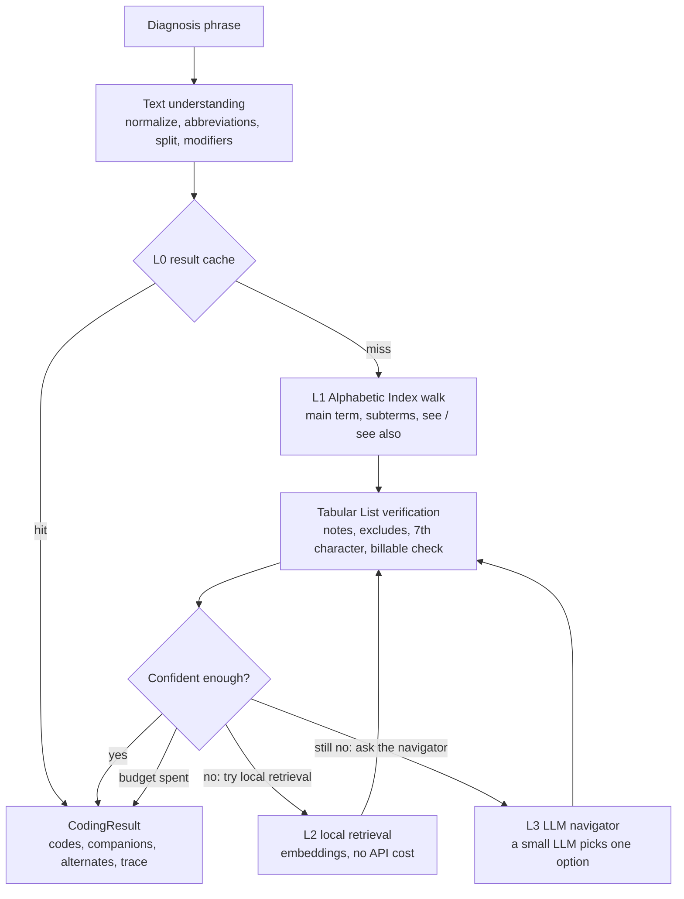

# text2icd

[](https://github.com/a2psilva/text2icd/actions/workflows/ci.yml)
[](LICENSE)
[](pyproject.toml)

Map clinical diagnosis phrases to **ICD-10-CM** codes by navigating the official CMS Alphabetic Index
and Tabular List the way a certified medical coder does: cheaply, transparently, and with an audit
trail for every code.

> **Status: alpha (v0.1.0).** The deterministic coder works: Index walk, Tabular verification,
> instructional notes and the main guideline rules, with no model and no API call
> ([results](docs/results.md)). Each code set carries a calibrated confidence that marks the
> phrases to escalate, and local retrieval (L2) recodes those on the CPU, at no API cost. A web UI
> (`text2icd serve`) shows each chunk's path to its code and explores the graph. The LLM
> navigator is built but has not been evaluated against a live API yet.


## Why

Automatic ICD coding usually takes one of two routes. String similarity against code descriptions is
fast but shallow, and it misses combination codes, 7th characters and instructional notes. Sending
everything to a large language model costs more per phrase, is hard to audit, and still invents codes.

Human coders do neither. They follow a documented procedure over two reference books: find the main
term in the Alphabetic Index, follow its subterms and cross-references, then verify the code in the
Tabular List and obey its notes ([Official Guidelines](https://www.cms.gov/medicare/coding-billing/icd-10-codes),
Section I.B.1). text2icd turns those books into a graph and follows the same procedure. It calls a
small LLM only at the few decision points where the wording is genuinely ambiguous, and then only to
pick one of the options the graph offers, so it can never return a code that does not exist.

## How it works



| Layer | What it does | Marginal cost |
| --- | --- | --- |
| L0 | Cache of previously coded phrases | $0 |
| L1 | Deterministic coder: Index navigation plus Tabular verification | $0 |
| L2 | Local embedding retrieval when the Index walk is unsure | $0 (CPU) |
| L3 | A small, low-cost LLM chooses among a graph node's children, with a per-phrase call cap | about $0.0002 per step (estimate) |

The design target is under $0.50 per 1,000 phrases with accuracy above an LLM-plus-retrieval
baseline. Both numbers will be measured, not assumed; see [docs/evaluation.md](docs/evaluation.md).
The deterministic coder alone (L1, $0) already reaches 94.2% accuracy@1 on the public
`cms-synthetic` test split, with no invalid code ([docs/results.md](docs/results.md)).
More detail is in [docs/architecture.md](docs/architecture.md) and
[docs/coder-workflow.md](docs/coder-workflow.md).

## Output

`text2icd code "type 2 DM with diabetic CKD stage 3a" --json` returns a `CodingResult`
([JSON Schema](docs/schema/coding-result.json)). Trimmed:

```json
{
  "input": "type 2 DM with diabetic CKD stage 3a",
  "release": "fy2027",
  "chunks": [
    {"id": 0, "text": "type 2 DM", "start": 0, "end": 9},
    {"id": 1, "text": "diabetic CKD stage 3a", "start": 15, "end": 36}
  ],
  "codes": [
    {"code": "E11.22", "description": "Type 2 diabetes mellitus with diabetic chronic kidney disease",
     "role": "diagnosis", "primary": true, "chunks": [0, 1], "path": 0},
    {"code": "N18.31", "description": "Chronic kidney disease, stage 3a",
     "role": "use_additional", "primary": false, "source": "E11.22", "chunks": [0, 1]}
  ],
  "confidence": 0.709,
  "resolver": "index",
  "trace": [
    {"layer": "text", "action": "abbreviation", "detail": "\"DM\" -> \"diabetes mellitus\""},
    {"layer": "index", "action": "see", "detail": "Diabetes -> Diabetes, diabetic", "guideline": "I.A.16"},
    {"layer": "index", "action": "code", "detail": "E11.22 at Diabetes, diabetic > type 2 > with > chronic kidney disease"},
    {"layer": "tabular", "action": "companion", "detail": "E11.22: use additional code ... (N18.1-N18.6)"}
  ],
  "cost_usd": 0.0
}
```

- **Chunks:** each chunk is a condition the phrase states, at the span where it was written.
- **Codes:** in coding order, each code lists the chunks it codes, its role, and the code whose
  note brought it in.
- **Confidence:** calibrated for the code set, as the chance that its primary code is right.
- **`--explain`:** adds each diagnosis's path through the Index (graph term ids) and the Tabular
  List, the instructional notes, Excludes1, the codes L2 weighed, and L3's decisions.

## Install

text2icd is not on PyPI: install it from GitHub, then let it set itself up.

```bash
uv tool install "text2icd[all] @ git+https://github.com/a2psilva/text2icd"
text2icd setup        # SQLite check, the graph, L2's vectors and model, then a check phrase
text2icd code "type 2 DM with diabetic CKD stage 3a"     # E11.22, N18.31
```

Or run the image, which has the FY2027 graph, L2's vectors and the model built in and needs no
network (about 660 MB; linux/amd64 and linux/arm64):

```bash
docker run --rm -p 127.0.0.1:8000:8000 ghcr.io/a2psilva/text2icd    # the UI at http://127.0.0.1:8000
docker run --rm ghcr.io/a2psilva/text2icd code "type 2 DM with diabetic CKD stage 3a"
```

[compose.yaml](compose.yaml) runs the service with a read-only file system. Images are pushed for
each release; `docker build -t text2icd .` builds one from a checkout (it fetches the CMS files
and embeds the graph, about 10 minutes on a laptop; a published data release saves the
embedding).

To install a fixed version, use its [release](https://github.com/a2psilva/text2icd/releases):
each one has the wheel, the sdist, `SHA256SUMS` and build provenance, and its notes give the
install line. Releasing is described in [docs/releasing.md](docs/releasing.md).

From Python:

```python
import text2icd

result = text2icd.code("type 2 DM with diabetic CKD stage 3a")
[c.code for c in result.codes]  # ['E11.22', 'N18.31']
for result in text2icd.code_many(["acute appendicitis", "hip fracture, initial encounter"]):
    print(result.primary.code, result.confidence)
```

`text2icd serve` starts the web UI and the HTTP service on http://127.0.0.1:8000 (the `api`
extra). The UI codes a phrase and draws each chunk's path: the main term, subterms and
cross-references in the Index, then the Tabular steps to the final code, with the notes that
brought in other codes; click a step to see that term or code. Its explorer searches the Index
and the Tabular List and follows them term by term. The API (docs at `/docs`): `POST /v1/code`
and `POST /v1/batch` code phrases, and `GET /v1/<release>/codes/<code>`, `/terms/<id>` and
`/search?q=` read the graph. `text2icd serve --review audit|gold` is the local review mode for
the MIMIC-IV hand reviews ([annotation guide](docs/annotation-guide.md)).

`text2icd demo export DIR` writes the UI as static files, with the deterministic coder's answers to
47 example phrases ([demo.toml](src/text2icd/resources/demo.toml)) and the graph pages they touch:
the GitHub Pages demo, which [pages.yml](.github/workflows/pages.yml) builds on version tags. Try
it locally with `python -m http.server -d DIR`.

`text2icd batch FILE` codes a file of phrases (JSON lines with `phrase` and `id`, CSV with a
`phrase` column, or one phrase per line; `-` reads stdin) and writes one JSON line per row, in
order: `{"line": 2, "id": "a1", "result": {...}}`, or `"error"` for a row it cannot code.

`text2icd setup` downloads the release's graph and vectors from this repository's data releases
when the installed version lists them, checking each file's SHA-256 and the graph's content hash.
Otherwise it fetches the two CMS files the graph needs from cms.gov and builds it (about 15 s);
L2 then needs `text2icd graph embed` (a few minutes). Files go to the per-user data directory;
`text2icd data where` shows them.

Extras: `embeddings` (L2, local retrieval), `llm`, `bedrock` and `vertex` (L3, the LLM
navigator), `eval` (the evaluation's static-embedding baseline and calibration fitting), and
`all` (`embeddings` and `llm`). `pip install "text2icd[all] @ git+https://github.com/a2psilva/text2icd"`
works too.

## Quickstart (development)

Requires [uv](https://docs.astral.sh/uv/).

```bash
git clone https://github.com/a2psilva/text2icd.git
cd text2icd
make install                 # .venv (Python 3.12, dev tools, every extra), and .env from .env.example
uv run pre-commit install    # enables the lint and data-safety hooks
uv run text2icd data where   # where the data goes: ./data in a checkout, through .env
uv run text2icd data fetch   # downloads and verifies the newest CMS ICD-10-CM release
uv run text2icd data stats   # parses it and checks it against the CMS code order file
uv run text2icd build-graph  # builds the knowledge graph (data/processed/, about 10 s)
uv run text2icd graph show "Pneumonia > aspiration"   # an Index term, its codes and subterms
uv run text2icd graph code E11.22                     # a code, its notes, edges and Index terms
uv run text2icd graph check  # runs the integrity checks on the built graph
uv run text2icd graph embed  # embeds its texts for local retrieval (about 3 min on a laptop CPU)
uv run text2icd parse "DM2 w/ CKD 3a, possible UTI 2/2 E. coli"   # how a phrase is read
uv run text2icd walk "aspiration pneumonia due to food"         # the Index walk's candidates
uv run text2icd code "type 2 DM with diabetic CKD stage 3a"      # the coder, then L2 if unsure
uv run text2icd code "DM2 w/ CKD 3a" --json --explain             # the result, with its paths
uv run text2icd batch phrases.csv -o coded.jsonl                  # a file of phrases, streamed
uv run text2icd eval run -d cms-synthetic-sample -s bm25 --split all   # the BM25 baseline
make check                   # lint, format check, type check, tests
```

## Data

| Source | License | Where it goes | Committed? |
| --- | --- | --- | --- |
| [CMS ICD-10-CM files](https://www.cms.gov/medicare/coding-billing/icd-10-codes) (Tables and Index XML, code order file, addenda, guidelines) | US public domain | `<data>/raw/cms/fy<YEAR>/` | No (downloaded by script) |
| [MIMIC-IV](https://physionet.org/content/mimiciv/) and [MIMIC-IV-Note](https://physionet.org/content/mimic-iv-note/) | PhysioNet Credentialed Health Data Use Agreement | `<data>/raw/mimic-iv/` | **Never** |

`<data>` is `TEXT2ICD_DATA_DIR` (or `--data-dir`): `./data` in a checkout, through its `.env`.
Unset, it is the per-user data directory (`~/Library/Application Support/text2icd` on macOS,
`~/.local/share/text2icd` on Linux, `%LOCALAPPDATA%\text2icd` on Windows), so an installed
text2icd finds its graph from any directory. `text2icd data where` shows the paths in use.

MIMIC-IV is used only for local evaluation. Its rules (no redistribution, no sharing with third
parties, LLM calls only through approved endpoints) are summarised in
[docs/data-and-compliance.md](docs/data-and-compliance.md). A pre-commit hook and a CI check block any
file under `data/` from being committed.

## Project layout

```
src/text2icd/
  ontology/   CMS XML parsers -> typed models
  graph/      knowledge graph build, SQLite + FTS5 storage, traversal
  text/       normalization, abbreviations, condition splitting, modifiers
  resolve/    the L0-L2 cascade and Tabular verification
  llm/        L3 navigator: providers, prompts, budget, endpoint policy
  api/        FastAPI service
  eval/       datasets, metrics, baselines, benchmark runner
tests/        unit and integration tests (CMS fixtures only)
docs/         architecture, decision records, coder workflow, data and compliance, evaluation
data/         local data (git-ignored)
notebooks/    exploration (notebooks/local/ is git-ignored)
```

## Contributing

See [CONTRIBUTING.md](CONTRIBUTING.md). Please read the data rules before opening an issue: never
paste MIMIC text or any patient data.

## Disclaimer

text2icd is a research tool. It is not a medical device and does not replace a certified coder.
Review every code before using it for billing, reporting or clinical decisions.

## License

[MIT](LICENSE). The ICD-10-CM classification files are published by CMS and are in the public domain.
