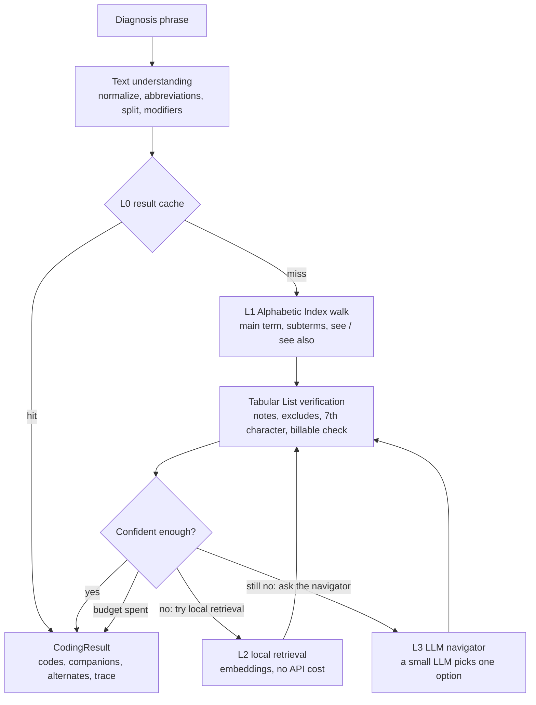

# text2icd

[](https://github.com/a2psilva/text2icd/actions/workflows/ci.yml)
[](LICENSE)
[](pyproject.toml)

Map clinical diagnosis phrases to **ICD-10-CM** codes by navigating the official CMS Alphabetic Index
and Tabular List the way a certified medical coder does: cheaply, transparently, and with an audit
trail for every code.

> **Status: pre-alpha.** This repository currently contains the project scaffold and the design
> docs. The resolver described below is under development.

## Why

Automatic ICD coding usually takes one of two routes. String similarity against code descriptions is
fast but shallow, and it misses combination codes, 7th characters and instructional notes. Sending
everything to a large language model costs more per phrase, is hard to audit, and still invents codes.

Human coders do neither. They follow a documented procedure over two reference books: find the main
term in the Alphabetic Index, follow its subterms and cross-references, then verify the code in the
Tabular List and obey its notes ([Official Guidelines](https://www.cms.gov/medicare/coding-billing/icd-10-codes),
Section I.B.1). text2icd turns those books into a graph and follows the same procedure. It calls a
small LLM only at the few decision points where the wording is genuinely ambiguous, and then only to
pick one of the options the graph offers, so it can never return a code that does not exist.

## How it works



| Layer | What it does | Marginal cost |
| --- | --- | --- |
| L0 | Cache of previously coded phrases | $0 |
| L1 | Deterministic coder: Index navigation plus Tabular verification | $0 |
| L2 | Local embedding retrieval when the Index walk is unsure | $0 (CPU) |
| L3 | A small, low-cost LLM chooses among a graph node's children, with a per-phrase call cap | about $0.0002 per step (estimate) |

The design target is under $0.50 per 1,000 phrases with accuracy above an LLM-plus-retrieval
baseline. Both numbers will be measured, not assumed; see [docs/evaluation.md](docs/evaluation.md).
More detail is in [docs/architecture.md](docs/architecture.md) and
[docs/coder-workflow.md](docs/coder-workflow.md).

## Target output

This example is illustrative; the resolver is not implemented yet. The codes and paths come from the
FY2026 CMS files.

```json
{
  "input": "type 2 DM with diabetic CKD stage 3a",
  "codes": [
    {
      "code": "E11.22",
      "description": "Type 2 diabetes mellitus with diabetic chronic kidney disease",
      "role": "primary",
      "confidence": 0.97
    },
    {
      "code": "N18.31",
      "description": "Chronic kidney disease, stage 3a",
      "role": "use_additional",
      "confidence": 0.95
    }
  ],
  "alternatives": [],
  "trace": [
    "text: 'DM' -> 'diabetes mellitus'; 'CKD' -> 'chronic kidney disease'",
    "index: Diabetes, diabetic > type 2 > with > chronic kidney disease -> E11.22",
    "tabular: E11.22 is billable; 'Use additional code to identify stage of chronic kidney disease (N18.1-N18.6)'",
    "index: Disease, diseased > kidney > chronic > stage 3a -> N18.31"
  ],
  "flags": [],
  "resolver": "index",
  "cost_usd": 0.0
}
```

## Quickstart (development)

Requires [uv](https://docs.astral.sh/uv/).

```bash
git clone https://github.com/a2psilva/text2icd.git
cd text2icd
uv sync --all-extras         # creates .venv with Python 3.12, the dev tools and local embeddings
uv run pre-commit install    # enables the lint and data-safety hooks
uv run text2icd data fetch   # downloads and verifies the newest CMS ICD-10-CM release
uv run text2icd data stats   # parses it and checks it against the CMS code order file
uv run text2icd build-graph  # builds the knowledge graph (data/processed/, about 10 s)
uv run text2icd graph show "Pneumonia > aspiration"   # an Index term, its codes and subterms
uv run text2icd graph code E11.22                     # a code, its notes, edges and Index terms
uv run text2icd graph check  # runs the integrity checks on the built graph
uv run text2icd eval run -d cms-synthetic-sample -s bm25 --split all   # the BM25 baseline
make check                   # lint, format check, type check, tests
```

## Data

| Source | License | Where it goes | Committed? |
| --- | --- | --- | --- |
| [CMS ICD-10-CM files](https://www.cms.gov/medicare/coding-billing/icd-10-codes) (Tables and Index XML, code order file, addenda, guidelines) | US public domain | `data/raw/cms/fy<YEAR>/` | No (downloaded by script) |
| [MIMIC-IV](https://physionet.org/content/mimiciv/) and [MIMIC-IV-Note](https://physionet.org/content/mimic-iv-note/) | PhysioNet Credentialed Health Data Use Agreement | `data/raw/mimic-iv/` | **Never** |

MIMIC-IV is used only for local evaluation. Its rules (no redistribution, no sharing with third
parties, LLM calls only through approved endpoints) are summarised in
[docs/data-and-compliance.md](docs/data-and-compliance.md). A pre-commit hook and a CI check block any
file under `data/` from being committed.

## Project layout

```
src/text2icd/
  ontology/   CMS XML parsers -> typed models
  graph/      knowledge graph build, SQLite + FTS5 storage, traversal
  text/       normalization, abbreviations, condition splitting, modifiers
  resolve/    the L0-L2 cascade and Tabular verification
  llm/        L3 navigator: providers, prompts, budget, endpoint policy
  api/        FastAPI service
  eval/       datasets, metrics, baselines, benchmark runner
tests/        unit and integration tests (CMS fixtures only)
docs/         architecture, decision records, coder workflow, data and compliance, evaluation
data/         local data (git-ignored)
notebooks/    exploration (notebooks/local/ is git-ignored)
```

## Contributing

See [CONTRIBUTING.md](CONTRIBUTING.md). Please read the data rules before opening an issue: never
paste MIMIC text or any patient data.

## Disclaimer

text2icd is a research tool. It is not a medical device and does not replace a certified coder.
Review every code before using it for billing, reporting or clinical decisions.

## License

[MIT](LICENSE). The ICD-10-CM classification files are published by CMS and are in the public domain.
