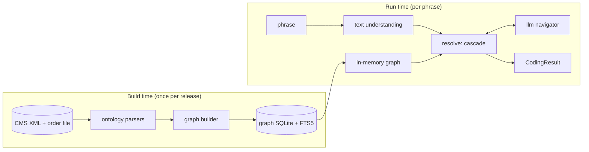

# Architecture

Status: design. The sections below describe the target system. Names of modules, tables and
fields are the planned ones and may be refined during implementation. The main design decisions,
with the alternatives that were considered, are recorded in [docs/adr/](adr/README.md).

## Goals and non-goals

Goals:

- Turn a diagnosis phrase into a valid, billable ICD-10-CM code set for a given fiscal-year release.
- Reproduce the coder's procedure (Index, then Tabular, then notes), so every code comes with a
  trace a human can audit.
- Keep the marginal cost close to zero: the deterministic path does most of the work, and an LLM
  is consulted only at ambiguous decision points, with hard limits.
- Never return a code that does not exist in the selected release.

Non-goals (for now): reading full notes, ICD-10-PCS procedure codes, principal-diagnosis sequencing
for an encounter, and reimbursement logic (MS-DRG, HCC).

## Component overview



| Package | Responsibility |
| --- | --- |
| `text2icd.ontology` | Stream-parse the CMS XML (Tabular, Index, External Cause Index, Neoplasm Table, Drug Table) and the code order file into typed records. No interpretation beyond what the files state. |
| `text2icd.graph` | Build nodes and edges from those records, resolve cross-references, persist to SQLite with FTS5, load into memory, and expose a traversal API. |
| `text2icd.text` | Normalize phrases, expand abbreviations, split a phrase into conditions, and extract modifiers and flags. |
| `text2icd.resolve` | The cascade: result cache (L0), Index walk (L1), Tabular verification, confidence, local retrieval (L2), and the orchestration that calls L3. |
| `text2icd.llm` | Provider clients, constrained-choice prompts, budget and call caps, and the endpoint policy. |
| `text2icd.api` | FastAPI service around `resolve`. |
| `text2icd.eval` | Datasets, metrics, baselines and the benchmark runner. |
| `text2icd.cli` | Typer CLI: `data fetch`, `build-graph`, `code`, `batch`, `eval`, `serve`. |

## Knowledge graph

### Node types

| Node | Key | Main attributes |
| --- | --- | --- |
| `Chapter` | chapter number | title, code range |
| `Block` (section) | section id, e.g. `E08-E13` | title |
| `TabularCode` | code with dot, e.g. `E11.22` | description, billable flag, placeholder flag, depth, inclusion terms, inherited 7th-character definition |
| `SeventhCharacter` | (owner code, char) | meaning, e.g. `A` = initial encounter |
| `IndexTerm` | stable id | source (`index`, `eindex`, `neoplasm`, `drug`), level, title, nonessential modifiers, full path, code, manifestation code, `subcat`, `seecat` |
| `TableCell` | (IndexTerm id, column) | code for one column of the Neoplasm or Drug table, e.g. *Malignant Primary* |

### Edge types

| Edge | From → To | Source in the XML |
| --- | --- | --- |
| `parent_of` | Tabular → Tabular | `<chapter>` / `<section>` / `<diag>` nesting |
| `has_subterm` | IndexTerm → IndexTerm | `<mainTerm>` / `<term level>` nesting |
| `points_to` | IndexTerm → TabularCode | `<code>`, `<subcat>`, `<seecat>` (a trailing `-` means "incomplete") |
| `manifestation` | IndexTerm → TabularCode | `<manif>` (sequenced after the etiology code) |
| `see`, `see_also` | IndexTerm → IndexTerm | `<see>`, `<seeAlso>` text resolved to an Index path |
| `excludes1`, `excludes2` | TabularCode → TabularCode or range | `<excludes1>`, `<excludes2>` note text, code references parsed out |
| `code_first`, `use_additional`, `code_also` | TabularCode → TabularCode or range | the matching note elements |

Cross-reference text such as `Pneumonia, in (due to)` is read as a path of comma-separated segments
and resolved by longest match, first against main-term titles, because titles themselves contain
commas (`Abdomen, abdominal`), then against subterms. Titles are compared in lenient forms (case,
parenthesized words, NEC and NOS, hyphens, apostrophes, plurals, the parts of comma and "or"
titles). Parts of a reference that are instructions are kept as such: `by site`, a table column
(`Neoplasm, benign, by site` is the Benign column of the Neoplasm Table, matched against the column
headings of the release), a book (`Table of Drugs and Chemicals`), a code instruction
(`category M01`) or a generic one (`condition`). A reference is `resolved`, `partial` (a term is
reached and the words left over are kept for the coder), `instruction`, or `unresolved`. In FY2026
and FY2027 about 88% resolve, 6% are partial, 6% are instructions, and 16 (0.1%) are unresolved;
those are errors in the Index, listed with a reason in `src/text2icd/resources/xref_exceptions.toml`.

### Billable code set

The XML lists most codes explicitly, but codes that need a 7th character exist only through an
inherited `sevenChrDef` (for example E08.3211). The builder generates them, padding with the `X`
placeholder where the code is shorter than six characters, and the result must match the CMS code
order file exactly.

### Storage

One SQLite file per release, for example `data/processed/text2icd-graph-fy2026.sqlite`, written by
`text2icd build-graph --release fy2026`:

- tables for tabular nodes, notes, edges, index terms, table cells and cross-references;
- FTS5 virtual tables over Index full paths, titles plus nonessential modifiers, Tabular descriptions
  and inclusion terms, which gives BM25 ranking without extra dependencies;
- a `meta` table with the release id, source file hashes and the builder version.

The schema is versioned SQL in `src/text2icd/graph/schema.sql`. Tables so far:

| Table | Content |
| --- | --- |
| `meta` | release id, schema and builder versions, SHA-256 of each source file, content hash |
| `order_code` | the CMS code order file as published: code, billable flag, short and long descriptions |
| `tabular_node` | chapters, sections, XML codes and the codes generated from 7th-character definitions, with parent, depth, billable flag, placeholder flag and the node whose 7th-character definition applies |
| `tabular_note` | every instructional note in document order, by XML element name (`excludes1`, `useAdditionalCode`, ...) |
| `seventh_char` | 7th-character definitions on the node that declares them |
| `index_term` | terms of the four Index books with global ids, essential title, printed title, nonessential modifiers and full path (`Pneumonia > aspiration > due to > food`) |
| `table_column` | column headings of the Neoplasm Table and the Table of Drugs and Chemicals |
| `index_pointer` | the `points_to` and `manifestation` edges: every code a term gives (`code`, `manif`, `subcat`, `seecat`, table cells), as written and resolved to a Tabular node, with a status (`ok`, `corrected`, `excluded`, `unresolved`) |
| `tabular_term` | searchable Tabular text linked to its code: every code description, inclusion term and `includes` note |
| `fts_index_term`, `fts_tabular` | contentless FTS5 tables over Index terms (title, nonessential modifiers and full path, weighted in that order) and over `tabular_term`; the tokenizer (`porter` by default, or `unicode61`) is chosen at build time and recorded in `meta` |
| `index_xref` | the `see` and `see_also` edges: every cross-reference as written, with its status, the term it reaches, the book, table column and instruction it names, the words left over, and for a known Index error the reason |
| `tabular_edge` | the `excludes1`, `excludes2`, `code_first`, `use_additional` and `code_also` edges: every code or range written in a note (any note kind), as written and as a range of code prefixes, with the Tabular node a single code names and a status (`ok`, `unresolved`) |

Generated codes take their description from the order file. Billable codes in `tabular_node` must
equal the billable rows of `order_code`. Known Index data errors are listed in
`src/text2icd/resources/index_exceptions.toml`: entries with a correction replace the written value
(status `corrected`), the others are kept out of the edges with a build warning (`excluded`).

Code references in notes are found with a pattern, then checked against the release. A range
resolves when at least one code lies inside it, since some ranges end at a WHO-only category
(`K00-K93`). A bare token that matches no code is a word, not a reference (`vitamin B12`,
`GM2 gangliosidosis`); the build log lists them. Any other reference with no code is kept as
`unresolved` with a warning: FY2026 has one, `G31.90` in a code-first note of F02.

The search tables use the `porter` tokenizer (English stemming) by default. It was chosen by
main-term recall (`text2icd eval main-terms`), the share of phrases for which Index search puts a
main term leading to the gold code among the first results. On 10,000 `mimic-silver` dev phrases
against FY2027, `porter` reaches 49.6% at 1 searching main terms (`unicode61`: 45.9%) and 88.3% at
10 searching all terms (83.6%). On `cms-synthetic` dev, whose wording follows the Index, the two
are within each other's intervals.

`text2icd graph check` runs the integrity checks on a built file: the content hash still matches,
both trees have no missing parent, bad depth or cycle, the billable codes equal the order file,
every Index pointer resolves (apart from the listed exceptions), every unresolved cross-reference
is listed with a reason and they stay under 1%, and the search tables are complete. Two checks warn
instead of failing, because what they find are errors or gaps in the CMS data: note references with
no code (FY2026 has one), and billable codes that no Index term leads to (37 in FY2027, 99.95% are
reached). The CI integration job fetches FY2026 and FY2027, runs the slow tests, builds both graphs
and checks them.

At run time `text2icd.graph.model.load(release)` reads the graph into plain dicts and named tuples,
so traversal never touches disk; search runs on the FTS5 tables through a read-only connection. For
FY2027 (98,722 Tabular nodes, 99,108 Index terms) loading takes about 0.85 s and peaks at about
255 MB resident on a recent laptop (targets: under 1 s and under 300 MB). SQLite was chosen over
networkx (memory-heavy, no full-text search) and over a graph database (an extra service to run):
it is a single portable file, needs no server, and can be attached to a GitHub Release because the
CMS content is public domain.

## Resolution cascade

### Text understanding

`text.parse` turns the phrase into a `ParsedPhrase` (`text.model`), and every step is a trace
entry (`text2icd.trace.TraceStep`). `text2icd parse "<phrase>"` shows the result.

1. **Normalise** (`text.normalize`): Unicode NFKC, dashes, quotes and spacing; clinical shorthand
   (`w/`, `w/o`, `s/p`, `c/b`, `2/2`, `h/o`, `r/o`); abbreviations from the lexicon
   `resources/abbreviations.toml` (`text.abbreviations`), before case folding so that `ALL` and
   `all` differ, with hint words for ambiguous ones (`altered MS` is mental status) and a flag
   when none applies; case folding; Roman numerals of stages and diabetes types.
2. **Modifiers** (`text.modifiers`): laterality, acuity, stage, severity, episode of care, fracture
   type, organism (named as the Index does), drug resistance, diabetes type and drugs, control,
   with or without complication, pregnancy and trimester, remission. Each has a canonical value
   and a span; the words stay in the phrase for the Index walk.
3. **Cues** (`text.cues`): history, family history, status post and resolved; negation; the
   uncertainty terms of Guideline II.H, before or after the condition they qualify.
4. **Split** (`text.split`): `;` and `,` separate items and fragments; linking connectors (`with`,
   `without`, `due to`, `secondary to`, `complicated by`, `in the setting of`, `on`) join conditions
   into one diagnosis, as relations the Index's connector subterms will use (I.A.15); `and`, `or`,
   `vs` and `/` list conditions side by side. Parts that name no condition (no word forming a
   condition main-term title of the Index, apart from body sites, modifiers and cues) refine or
   qualify the condition next to them: `pneumonia, right lower lobe`, `UTI due to E. coli`. CMS
   terms written with "and" (`hand, foot and mouth disease`) and pairs the Index lists under
   "with" (`nausea and vomiting`) stay whole. Modifier and cue spans are never cut.
5. **Judge** each condition from the cues that cover it: its status, certainty, and whether it is
   coded in the `setting`. Inpatient (the default), an uncertain diagnosis is coded as if
   established (II.H, III.C) and comparative ones are both coded (II.D); outpatient, it is not
   coded and the symptoms are (IV.H). Negated conditions are not coded. "Resolved" is a personal
   history, never "in remission" (I.C.4.a.1(b)).

A `ParsedPhrase` holds the original and normalised text, the conditions (text without cue words,
span, modifiers, cues, status, certainty, reportable), the relations, the diagnoses (conditions
joined by linking relations), the abbreviation expansions, unknown abbreviation-like tokens, flags
and the trace. The graph's terms (`text.terms.Terms`) are optional: without them, any words
besides modifiers and cues name a condition.

### L0: result cache

Key: normalized phrase, release id, resolver version and settings. Stored in a local SQLite file
under `.text2icd/` (git-ignored, because cached phrases may come from restricted data).

### L1: deterministic coder

1. **Route** each condition to the Neoplasm Table, the Drug Table, the External Cause Index, or the
   main Index, based on morphology words, poisoning or adverse-effect language, and external-cause
   language.
2. **Select the main term** (`text2icd.resolve.main_terms`): the main terms whose title holds a
   word of the phrase, compared in shared forms (`text2icd.resolve.words`: singular, and the noun
   of an anatomical adjective from `resources/word_forms.toml`, so renal and kidney are one word),
   after correcting typos to the nearest Index word (`rapidfuzz`, one edit, two from nine
   letters). FTS5 BM25 over titles and nonessential modifiers supplies main terms when no title
   holds a word. Main terms that only say "see condition" (`Kidney`) are dropped, so the condition
   wins over the anatomical site. Candidates are ranked by what the main term uses plus what its
   subterms could still use (`text2icd.resolve.profiles`), then by whether the main term holds the
   head noun of the phrase. Follow `see` redirects.
3. **Descend** subterms (`text2icd.resolve.walk`) with a beam search of width 5 from the five
   best main terms. Each diagnosis of the parsed phrase is walked on its own, without the wording
   only a 7th character carries ("initial encounter"); two neighbouring diagnoses are joined when
   one path uses every word their separate walks use ("abuse with psychosis, delusions"). A
   subterm is taken when it uses phrase words not used yet: 1 for each essential word, 0.8 for
   each word of a nonessential modifier, minus 0.6 for each essential word the phrase does not
   document. A subterm can take a word a nonessential modifier above it used, so when the two are
   mutually exclusive the subentry wins (I.A.7). Connector subterms with no words of their own
   ("with", "due to") are passed through; a "without" subterm needs "without" in the phrase, and
   under "with" no subterm may use a word the phrase puts after "without". Every state is a
   candidate, coded by its own term or the nearest term above it with a code; the main term's
   code, or that of an "unspecified" subterm of a term without one, is the default code
   (Guideline I.A.18), flagged `default_code_used`. A subterm that only says "see" gives no
   default code. The result is ranked candidates (code, possibly partial; score; path; flags;
   trace); `text2icd walk "<phrase>"` prints them.
4. **Pick the table column** for Neoplasm (behaviour) and Drug (intent: accidental, self-harm,
   assault, undetermined, adverse effect, underdosing) entries.

### Tabular verification

Shared by every layer, so L2 and L3 can only propose; Tabular verification decides.

- Descend from a category or partial code to a billable code, matching modifiers against child
  descriptions and inclusion terms. If the phrase gives no further detail, choose the "unspecified"
  child and add a flag.
- Apply the 7th character from the inherited definition and pad placeholders.
- Check the code exists in the release's billable set.
- Read notes: report Excludes1 conflicts within the code set, add `use_additional` and `code_first`
  requirements as companion codes (resolved when the phrase supports them, otherwise listed as
  required but unresolved), and order etiology before manifestation.
- Apply guideline rules, each citing its section (for example I.A.15 "with", I.C.9.a hypertension).

### Confidence and escalation

Features: share of input tokens consumed by the path, score margin between the two best paths,
whether a default or "unspecified" code was used, the number of Tabular children left undecided, and
fuzzy-match distance. A calibrated model (isotonic regression on the dev split) maps the features to
the probability that the primary code is correct. Below the threshold, the cascade tries L2, then L3.

### L2: local retrieval

Embeddings run on CPU through ONNX (fastembed or model2vec; the model is chosen by benchmark)
over Index full paths, Tabular descriptions and inclusion terms. Retrieved codes are fed back
into Tabular verification. No API cost.

### L3: LLM navigator

The LLM never writes a code. It chooses among options the graph provides:

- which candidate main term is right,
- which child to take at an ambiguous Index or Tabular node,
- what an unknown abbreviation means, from a short candidate list.

Prompt layout, from most stable to least, so caching works: a fixed system prompt with the coding
rules (long enough to meet the provider's minimum for prompt caching), then the phrase, the
path so far, and the numbered options. The response is a structured output whose `choice` field is
an enum of the option ids plus `none`. Requests use low reasoning effort and a small output limit.

Limits: a per-phrase call cap, a per-run dollar budget, and a cost log entry per call. When a limit is
reached the cascade returns the best deterministic answer with a `needs_review` flag.

Providers: hosted LLM services (for example Amazon Bedrock or Google Vertex AI) behind one
interface. With `require_dua_compliant_endpoint` on, only endpoints listed as approved in
[data-and-compliance.md](data-and-compliance.md) can be used. Offline evaluation uses the
provider's batch API where one exists, since batch requests are usually discounted.

## Output schema

```python
class AssignedCode(BaseModel):
    code: str  # "E11.22", always billable in the selected release
    description: str
    role: Literal["primary", "manifestation", "use_additional", "code_also", "external_cause"]
    confidence: float  # calibrated probability


class TraceStep(BaseModel):
    layer: Literal["text", "cache", "index", "tabular", "retrieval", "llm"]
    action: str  # e.g. "subterm", "see", "default_code", "seventh_character"
    detail: str  # human-readable, e.g. "Diabetes, diabetic > type 2 > with"
    guideline: str | None  # e.g. "I.A.15"


class CodingResult(BaseModel):
    input: str
    release: str  # e.g. "fy2026"
    codes: list[AssignedCode]  # ordered: etiology before manifestation
    alternatives: list[AssignedCode]
    trace: list[TraceStep]
    flags: list[str]  # e.g. "default_code_used", "unspecified_chosen", "needs_review"
    resolver: Literal["cache", "index", "retrieval", "llm"]
    llm_calls: int
    cost_usd: float
```

## Cost model

Per L3 step with a small model priced at about $0.10 per million input tokens and $0.50 per million
output tokens: about 300 uncached input tokens and a few hundred output tokens including reasoning
at low effort, so roughly $0.0002. With at most a few steps per escalated phrase and most phrases
resolved by L0 to L2,
the target is under $0.50 per 1,000 phrases. The evaluation harness measures the real figure,
including the cache hit rate, from the `usage` fields of each response.

## Releases and reproducibility

- A release is a CMS fiscal year plus an optional mid-year update: `fy2026`, `fy2026-apr`, `fy2027`.
  Every artifact, cache key and result carries its release id.
- The builder is deterministic: the same input files give the same graph content, checked by a
  content hash over the sorted rows. Source file hashes are recorded in `meta`.
- LLM-backed runs pin the model id and record it in the result, so benchmark runs can be repeated.
