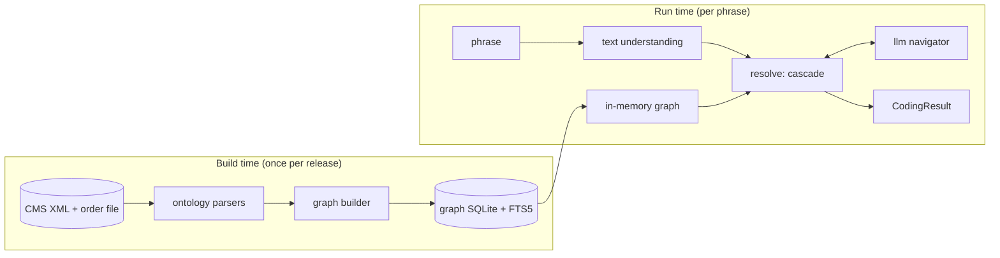

# Architecture

Status: design. The sections below describe the target system. Names of modules, tables and
fields are the planned ones and may be refined during implementation. The main design decisions,
with the alternatives that were considered, are recorded in [docs/adr/](adr/README.md).

## Goals and non-goals

Goals:

- Turn a diagnosis phrase into a valid, billable ICD-10-CM code set for a given fiscal-year release.
- Reproduce the coder's procedure (Index, then Tabular, then notes), so every code comes with a
  trace a human can audit.
- Keep the marginal cost close to zero: the deterministic path does most of the work, and an LLM
  is consulted only at ambiguous decision points, with hard limits.
- Never return a code that does not exist in the selected release.

Non-goals (for now): reading full notes, ICD-10-PCS procedure codes, principal-diagnosis sequencing
for an encounter, and reimbursement logic (MS-DRG, HCC).

## Component overview



| Package | Responsibility |
| --- | --- |
| `text2icd.ontology` | Stream-parse the CMS XML (Tabular, Index, External Cause Index, Neoplasm Table, Drug Table) and the code order file into typed records. No interpretation beyond what the files state. |
| `text2icd.graph` | Build nodes and edges from those records, resolve cross-references, persist to SQLite with FTS5, load into memory, and expose a traversal API. |
| `text2icd.text` | Normalize phrases, expand abbreviations, split a phrase into conditions, and extract modifiers and flags. |
| `text2icd.resolve` | The cascade: result cache (L0), Index walk (L1), Tabular verification, confidence, local retrieval (L2), and the orchestration that calls L3. |
| `text2icd.llm` | Provider clients, constrained-choice prompts, budget and call caps, and the endpoint policy. |
| `text2icd.api` | FastAPI service around `resolve`. |
| `text2icd.eval` | Datasets, metrics, baselines and the benchmark runner. |
| `text2icd.cli` | Typer CLI: `data fetch`, `build-graph`, `code`, `batch`, `eval`, `serve`. |

## Knowledge graph

### Node types

| Node | Key | Main attributes |
| --- | --- | --- |
| `Chapter` | chapter number | title, code range |
| `Block` (section) | section id, e.g. `E08-E13` | title |
| `TabularCode` | code with dot, e.g. `E11.22` | description, billable flag, placeholder flag, depth, inclusion terms, inherited 7th-character definition |
| `SeventhCharacter` | (owner code, char) | meaning, e.g. `A` = initial encounter |
| `IndexTerm` | stable id | source (`index`, `eindex`, `neoplasm`, `drug`), level, title, nonessential modifiers, full path, code, manifestation code, `subcat`, `seecat` |
| `TableCell` | (IndexTerm id, column) | code for one column of the Neoplasm or Drug table, e.g. *Malignant Primary* |

### Edge types

| Edge | From → To | Source in the XML |
| --- | --- | --- |
| `parent_of` | Tabular → Tabular | `<chapter>` / `<section>` / `<diag>` nesting |
| `has_subterm` | IndexTerm → IndexTerm | `<mainTerm>` / `<term level>` nesting |
| `points_to` | IndexTerm → TabularCode | `<code>`, `<subcat>`, `<seecat>` (a trailing `-` means "incomplete") |
| `manifestation` | IndexTerm → TabularCode | `<manif>` (sequenced after the etiology code) |
| `see`, `see_also` | IndexTerm → IndexTerm | `<see>`, `<seeAlso>` text resolved to an Index path |
| `excludes1`, `excludes2` | TabularCode → TabularCode or range | `<excludes1>`, `<excludes2>` note text, code references parsed out |
| `code_first`, `use_additional`, `code_also` | TabularCode → TabularCode or range | the matching note elements |

Cross-reference text such as `Pneumonia, in (due to)` is read as a path of comma-separated segments
and resolved by longest match, first against main-term titles, because titles themselves contain
commas (`Abdomen, abdominal`), then against subterms. Titles are compared in lenient forms (case,
parenthesized words, NEC and NOS, hyphens, apostrophes, plurals, the parts of comma and "or"
titles). Parts of a reference that are instructions are kept as such: `by site`, a table column
(`Neoplasm, benign, by site` is the Benign column of the Neoplasm Table, matched against the column
headings of the release), a book (`Table of Drugs and Chemicals`), a code instruction
(`category M01`) or a generic one (`condition`). A reference is `resolved`, `partial` (a term is
reached and the words left over are kept for the coder), `instruction`, or `unresolved`. In FY2026
and FY2027 about 88% resolve, 6% are partial, 6% are instructions, and 16 (0.1%) are unresolved;
those are errors in the Index, listed with a reason in `src/text2icd/resources/xref_exceptions.toml`.

### Billable code set

The XML lists most codes explicitly, but codes that need a 7th character exist only through an
inherited `sevenChrDef` (for example E08.3211). The builder generates them, padding with the `X`
placeholder where the code is shorter than six characters, and the result must match the CMS code
order file exactly.

### Storage

One SQLite file per release, for example `data/processed/text2icd-graph-fy2026.sqlite`, written by
`text2icd build-graph --release fy2026`:

- tables for tabular nodes, notes, edges, index terms, table cells and cross-references;
- FTS5 virtual tables over Index full paths, titles plus nonessential modifiers, Tabular descriptions
  and inclusion terms, which gives BM25 ranking without extra dependencies;
- a `meta` table with the release id, source file hashes and the builder version.

The schema is versioned SQL in `src/text2icd/graph/schema.sql`. Tables so far:

| Table | Content |
| --- | --- |
| `meta` | release id, schema and builder versions, SHA-256 of each source file, content hash |
| `order_code` | the CMS code order file as published: code, billable flag, short and long descriptions |
| `tabular_node` | chapters, sections, XML codes and the codes generated from 7th-character definitions, with parent, depth, billable flag, placeholder flag and the node whose 7th-character definition applies |
| `tabular_note` | every instructional note in document order, by XML element name (`excludes1`, `useAdditionalCode`, ...) |
| `seventh_char` | 7th-character definitions on the node that declares them |
| `index_term` | terms of the four Index books with global ids, essential title, printed title, nonessential modifiers and full path (`Pneumonia > aspiration > due to > food`) |
| `table_column` | column headings of the Neoplasm Table and the Table of Drugs and Chemicals |
| `index_pointer` | the `points_to` and `manifestation` edges: every code a term gives (`code`, `manif`, `subcat`, `seecat`, table cells), as written and resolved to a Tabular node, with a status (`ok`, `corrected`, `excluded`, `unresolved`) |
| `tabular_term` | searchable Tabular text linked to its code: every code description, inclusion term and `includes` note |
| `fts_index_term`, `fts_tabular` | contentless FTS5 tables over Index terms (title, nonessential modifiers and full path, weighted in that order) and over `tabular_term`; the tokenizer (`porter` by default, or `unicode61`) is chosen at build time and recorded in `meta` |
| `index_xref` | the `see` and `see_also` edges: every cross-reference as written, with its status, the term it reaches, the book, table column and instruction it names, the words left over, and for a known Index error the reason |
| `tabular_edge` | the `excludes1`, `excludes2`, `code_first`, `use_additional` and `code_also` edges: every code or range written in a note (any note kind), as written and as a range of code prefixes, with the Tabular node a single code names and a status (`ok`, `unresolved`) |

Generated codes take their description from the order file. Billable codes in `tabular_node` must
equal the billable rows of `order_code`. Known Index data errors are listed in
`src/text2icd/resources/index_exceptions.toml`: entries with a correction replace the written value
(status `corrected`), the others are kept out of the edges with a build warning (`excluded`).

Code references in notes are found with a pattern, then checked against the release. A range
resolves when at least one code lies inside it, since some ranges end at a WHO-only category
(`K00-K93`). A bare token that matches no code is a word, not a reference (`vitamin B12`,
`GM2 gangliosidosis`); the build log lists them. Any other reference with no code is kept as
`unresolved` with a warning: FY2026 has one, `G31.90` in a code-first note of F02.

The search tables use the `porter` tokenizer (English stemming) by default. It was chosen by
main-term recall (`text2icd eval main-terms`), the share of phrases for which Index search puts a
main term leading to the gold code among the first results. On 10,000 `mimic-silver` dev phrases
against FY2027, `porter` reaches 49.6% at 1 searching main terms (`unicode61`: 45.9%) and 88.3% at
10 searching all terms (83.6%). On `cms-synthetic` dev, whose wording follows the Index, the two
are within each other's intervals.

`text2icd graph check` runs the integrity checks on a built file: the content hash still matches,
both trees have no missing parent, bad depth or cycle, the billable codes equal the order file,
every Index pointer resolves (apart from the listed exceptions), every unresolved cross-reference
is listed with a reason and they stay under 1%, and the search tables are complete. Two checks warn
instead of failing, because what they find are errors or gaps in the CMS data: note references with
no code (FY2026 has one), and billable codes that no Index term leads to (37 in FY2027, 99.95% are
reached). The CI integration job fetches FY2026 and FY2027, runs the slow tests, builds both graphs
and checks them.

At run time `text2icd.graph.model.load(release)` reads the graph into plain dicts and named tuples,
so traversal never touches disk; search runs on the FTS5 tables through a read-only connection. For
FY2027 (98,722 Tabular nodes, 99,108 Index terms) loading takes about 0.85 s and peaks at about
255 MB resident on a recent laptop (targets: under 1 s and under 300 MB). A loaded graph is
safe to share between threads: each thread that searches opens its own read-only connection.
The decision cache and the cost meter take a lock, and the memos keyed by input words are
bounded. SQLite was chosen over
networkx (memory-heavy, no full-text search) and over a graph database (an extra service to run):
it is a single portable file, needs no server, and can be attached to a GitHub Release because the
CMS content is public domain.

## Resolution cascade

### Text understanding

`text.parse` turns the phrase into a `ParsedPhrase` (`text.model`), and every step is a trace
entry (`text2icd.trace.TraceStep`). `text2icd parse "<phrase>"` shows the result.

1. **Normalise** (`text.normalize`): Unicode NFKC, dashes, quotes and spacing; clinical shorthand
   (`w/`, `w/o`, `s/p`, `c/b`, `2/2`, `h/o`, `r/o`); abbreviations from the lexicon
   `resources/abbreviations.toml` (`text.abbreviations`), before case folding so that `ALL` and
   `all` differ, with hint words for ambiguous ones (`altered MS` is mental status) and a flag
   when none applies; case folding; Roman numerals of stages and diabetes types.
2. **Modifiers** (`text.modifiers`): laterality, acuity, stage, severity, episode of care, fracture
   type, organism (named as the Index does), drug resistance, diabetes type and drugs, control,
   with or without complication, pregnancy and trimester, remission. Each has a canonical value
   and a span; the words stay in the phrase for the Index walk.
3. **Cues** (`text.cues`): history, family history, status post and resolved; negation; the
   uncertainty terms of Guideline II.H, before or after the condition they qualify.
4. **Split** (`text.split`): `;` and `,` separate items and fragments; linking connectors (`with`,
   `without`, `due to`, `secondary to`, `complicated by`, `in the setting of`, `on`) join conditions
   into one diagnosis, as relations the Index's connector subterms will use (I.A.15); `and`, `or`,
   `vs` and `/` list conditions side by side. Parts that name no condition (no word forming a
   condition main-term title of the Index, apart from body sites, modifiers and cues) refine or
   qualify the condition next to them: `pneumonia, right lower lobe`, `UTI due to E. coli`. CMS
   terms written with "and" (`hand, foot and mouth disease`) and pairs the Index lists under
   "with" (`nausea and vomiting`) stay whole. Modifier and cue spans are never cut.
5. **Judge** each condition from the cues that cover it: its status, certainty, and whether it is
   coded in the `setting`. Inpatient (the default), an uncertain diagnosis is coded as if
   established (II.H, III.C) and comparative ones are both coded (II.D); outpatient, it is not
   coded and the symptoms are (IV.H). Negated conditions are not coded. "Resolved" is a personal
   history, never "in remission" (I.C.4.a.1(b)).

A `ParsedPhrase` holds the original and normalised text, the conditions (text without cue words,
span, modifiers, cues, status, certainty, reportable), the relations, the diagnoses (conditions
joined by linking relations), the abbreviation expansions, unknown abbreviation-like tokens, flags
and the trace. The graph's terms (`text.terms.Terms`) are optional: without them, any words
besides modifiers and cues name a condition.

### L0: result cache

Key: normalized phrase, release id, resolver version and settings. Stored in a local SQLite file
under `.text2icd/` (git-ignored, because cached phrases may come from restricted data).

### L1: deterministic coder

1. **Route** each diagnosis (`text2icd.resolve.route`). Behaviour wording ("malignant neoplasm
   of", "secondary malignant", "carcinoma in situ", "benign", "uncertain" or "unspecified
   behavior", "cancer of") starts a walk in the Neoplasm Table at that column, with the rest of
   the phrase as the site; morphology words ("adenocarcinoma") reach it through their Index
   cross-references. Poisoning, overdose, adverse-effect, underdosing and toxicity wording starts
   walks in the Table of Drugs and Chemicals at the intent column: self-harm, assault and
   undetermined only when written, accidental when the intent is unknown (I.C.19.e.5(b)), and
   toxicity read as an adverse effect (flagged). The cue words count as used, so routed walks
   compete with the main Index walk; cues are read after typo correction. A stated mechanism of
   injury (a fall, a collision, a bite) adds an External Cause Index walk whose codes have role
   `external_cause`. Conditions that are not current are looked up under History (personal or
   family) or Status (I.C.21.c), and only codes of that kind answer them: a family history code
   for a family history, never the personal history the Index's "see also" offers; for a
   personal history a Z code or what the History entry leads to (I25.2 for "history of MI"),
   never the current condition. Under History, "cancer" reads "malignant neoplasm".
2. **Select the main term** (`text2icd.resolve.main_terms`): the main terms whose title holds a
   word of the phrase, compared in shared forms (`text2icd.resolve.words`: singular, and the noun
   of an anatomical adjective from `resources/word_forms.toml`, so renal and kidney are one word),
   after correcting typos to the nearest Index word (`rapidfuzz`, one edit, two from nine
   letters). FTS5 BM25 over titles and nonessential modifiers supplies main terms when no title
   holds a word. Main terms that only say "see condition" (`Kidney`) are dropped, so the condition
   wins over the anatomical site. Candidates are ranked by what the main term uses plus what its
   subterms could still use (`text2icd.resolve.profiles`), then by whether the main term holds the
   head noun of the phrase.
3. **Descend** subterms (`text2icd.resolve.walk`) with a beam search of width 5 from the five
   best main terms. Each diagnosis of the parsed phrase is walked on its own, without the wording
   only a 7th character carries ("initial encounter"); two neighbouring diagnoses are joined when
   one path uses every word their separate walks use ("abuse with psychosis, delusions"), but
   for a stage the combination code leaves to its `use additional code` note ("type 2 diabetes,
   CKD stage 3a": E11.22, then N18.31, I.A.15). A main term the phrase says is absent is never
   taken ("sepsis without septic shock"). A
   subterm is taken when it uses phrase words not used yet: 1 for each essential word, 0.8 for
   each word of a nonessential modifier, minus 0.6 for each essential word the phrase does not
   document. A subterm can take a word a nonessential modifier above it used, so when the two are
   mutually exclusive the subentry wins (I.A.7). Connector subterms with no words of their own
   ("with", "due to") are passed through; a "without" subterm needs "without" in the phrase, and
   under "with" no subterm may use a word the phrase puts after "without". Every state is a
   candidate, coded by its own term or the nearest term above it with a code; the main term's
   code, or that of an "unspecified" subterm of a term without one, is the default code
   (Guideline I.A.18), flagged `default_code_used`. A subterm that only says "see" gives no
   default code. The result is ranked candidates (code, possibly partial; score; path; flags;
   trace); `text2icd walk "<phrase>"` prints them.
4. **Connectors** (I.A.15): "with" and "in" in the Index link the conditions even when the phrase
   only lists them ("type 2 diabetes, CKD" gives `Diabetes, diabetic > type 2 > with > chronic
   kidney disease`), recorded as `presumed_link`. "due to" needs the phrase to state the cause; a
   path through it otherwise costs like an undocumented word and is flagged `undocumented_link`,
   and listed diagnoses are never joined through it.
5. **Follow cross-references** (I.A.16): `see` jumps to its target (`Tapeworm` to `Infestation >
   tapeworm`), `see also` adds the target as another branch, and the walk continues there with the
   words not used yet, plus those a partial reference leaves. The target's title costs what the
   phrase does not document, and at equal scores a code given directly beats one reached by a
   reference. References into the Neoplasm Table carry their column (`Adenocarcinoma` - see also
   `Neoplasm, malignant, by site` reads the Malignant Primary cells). No term is visited twice,
   and at most three references are followed on a path.
6. **Read the table column**: a table walk takes its codes from the cells of the column the
   router or a cross-reference chose.

### Tabular verification

Shared by every layer, so L2 and L3 can only propose; Tabular verification decides.

- Descend from a category or partial code to a billable code (`text2icd.resolve.tabular`): each
  child is scored by the words that set it apart from its parent, in its description or an
  inclusion term (1 for each the phrase holds, minus 0.6 for each it does not). If the phrase
  gives no further detail, take the child whose description adds "unspecified" (I.A.9.b, I.B.18),
  flagged `unspecified_chosen`; with no such child, the best one, flagged `needs_review`. A
  fracture not stated as displaced is coded as displaced (I.C.19.c.1).
- Apply the 7th character from the inherited definition (I.A.5): for injuries, the episode of care
  the phrase states (initial, subsequent, sequela; for fractures also open or closed, closed by
  default, and the healing, routine by default), or `TEXT2ICD_DEFAULT_EPISODE`, flagged
  `seventh_character_assumed`; other 7th characters (eye, fetus) by their words. The generated
  codes carry their `X` placeholders (I.A.4).
- Only billable codes come out: the coder (`text2icd.resolve.coder`) completes the Index
  candidates in rank order and keeps the first that completes; a diagnosis none completes gets no
  code and the flag `needs_review`. `text2icd code "<phrase>"` prints the code set and its trace.
- Read the instructional notes (`text2icd.resolve.instructions`). A code reads its own notes and
  those of the categories above it.
  - *Companion codes* (I.B.7): for each `code first`, `use additional code` and `code also`
    instruction, a code of the set it names answers it; otherwise the coder looks for one among
    the Index paths the phrase documents in full (no undocumented slot). These are the walk's
    candidates, and for a diagnosis of several conditions a second walk of each condition alone,
    so "type 2 DM with CKD stage 3a" gives E11.22 and then N18.31 (`use additional code to
    identify stage of chronic kidney disease (N18.1-N18.6)`). An instruction is *mandatory*,
    *conditional* ("if applicable", "if known", "any", or external causes only, I.C.20), or one
    of a list of *alternatives* (the items under a heading, or notes that are not each a whole
    "code to identify ..." instruction: I13.0's heart failure and CKD stage notes are both
    mandatory). An optional one is coded only when its path uses a word the source's path does
    not, so "genetic susceptibility to malignant neoplasm" adds no neoplasm. A mandatory `use
    additional code` found nowhere takes the unspecified code it names when the source's title
    states the condition (I13.0 with no stage documented: N18.9, I.A.9.b); an etiology to code
    first is never presumed. Otherwise a mandatory instruction is listed as
    `required_unresolved`: "use additional code" means "if known", so it asks for review and
    does not invalidate the set.
  - *Excludes1* (I.A.12.a): two codes of different diagnoses that exclude one another cannot
    both stay; the more specific one is kept (more characters, then not an unspecified or
    default code, then the higher score). The other code, and the codes it brought in, are
    listed under `excluded` with the flag `excludes1_conflict`, since unrelated conditions are
    an exception a reviewer can apply. Excludes2 pairs are allowed (I.A.12.b).
  - *Sequencing*: `code first` puts the named code before, `use additional code` after, and
    `code also` gives no order (I.B.7). An Index manifestation follows its etiology, and a code
    "in diseases classified elsewhere" is never primary (I.A.13). A manifestation code with no
    etiology coded before it lists its `code first` instructions as `required_unresolved`
    ("anemia in neoplastic disease", D63.0).
  The code set's `sequence` gives each code with its role (`diagnosis`, `manifestation`,
  `code_first`, `use_additional`, `code_also`, `external_cause`) and the code that brought it in.
- Apply the guideline rule pack (`text2icd.resolve.rules`), each rule writing a `rules` trace
  step with its section:
  - *Combination codes* (I.B.9): a condition, or a comma-separated part of one, that the code
    of its diagnosis leaves entirely unused, and that the code's title and inclusion terms do
    not name either, is coded on its own when the Index codes it in full ("hypertension with CKD
    stage 4": N18.4 alone says nothing of the hypertension). A part must hold a word of a main
    term that is not just a site, and the parts of a Drug or Neoplasm Table entry ("substance,
    form") are names, not conditions. A mechanism of injury is left to the external cause code.
  - *Acute and chronic* (I.B.8): a condition described as both, whose code is no combination
    code, gets both codes, the acute one first, when the Index has a subentry for each ("acute
    on chronic renal failure": N17.9, N18.9).
  - *Hypertension* (I.C.9.a.1-3): the set's I10-I13 code becomes I11 with a heart condition
    (I50.-, I51.4-I51.7, I51.89, I51.9), I12 with CKD, I13 with both, the fourth and fifth
    characters read from the code of each condition on its own (heart failure, stage 5 or ESRD).
    Hypertension in pregnancy keeps its Chapter 15 codes (I.C.15.d). The I50 and N18 codes follow from the
    `use additional code` notes; an I51 code the I11 or I13 code includes is excluded by its own
    Excludes1 note without a conflict flag.
  - *Sepsis* (I.C.1.d.4): severe sepsis is R65.20, with septic shock R65.21, after the
    systemic infection, A41.9 when none is documented; a localized infection of the same
    diagnosis comes after. "Without septic shock" is R65.20: the walk takes no main term the
    phrase says is absent.
  - *Diabetes* (I.C.4.a.2-3): a diabetes of no documented type is type 2 (the Index default,
    traced); insulin, oral and injectable non-insulin drugs, by name too ("on metformin"),
    answer the `use additional code` notes of E08-E13 with Z79.4, Z79.84, Z79.85, all that
    apply. Their words are not walked, so "oral" never leads to oral complications.
  - *Drugs* (I.C.19.e.5): a poisoning or toxic effect code before the manifestations of its
    diagnosis, an adverse effect or underdosing code after the condition it caused.
  - *Sequelae* (I.B.10): the residual condition before the injury code with 7th character S.

### Confidence and escalation

`resolve.confidence` reads features off each code set and the Index walk behind its primary code:

- the share of the diagnosis's words its path uses, and of the whole phrase's words;
- the score margin to the best path to another code, and whether an earlier candidate failed to
  complete;
- undocumented slots and undocumented "due to" links;
- the Index default (I.A.18), an unspecified child, a tie among Tabular children, an assumed 7th
  character;
- typo corrections, cross-references followed, codes from the Neoplasm Table or the Table of
  Drugs;
- whether a rule or note put another code first, a diagnosis left without a code, an unresolved
  instruction;
- the text flags: ambiguous or unknown abbreviation, uncertainty, history.

A logistic score over the features, then an isotonic map, gives `confidence`: the probability that
the primary code is right. Both are a small table, `resources/calibration.json`, fitted on the
`cms-synthetic` dev split by `text2icd eval calibrate`; the runtime reads it with the standard
library, without scikit-learn. The table's threshold is chosen for a target precision of the code
sets kept (98%). A code set below it is marked `escalate`, and the cascade tries L2, then L3.
`TEXT2ICD_CALIBRATION` points at another table, for example one fitted locally on MIMIC-IV, which is
never shipped.

### L2: local retrieval

`resolve.retrieve` ranks the graph's own texts against the normalised phrase: Tabular
descriptions, inclusion terms and `includes` notes, and the full paths of the Index terms that give
a code. It returns distinct codes, which Tabular verification completes to billable ones, as it
does the Index walk's candidates. Embeddings run on the CPU, without torch. The benchmark of task
7.4 ([evaluation](evaluation.md#local-retrieval-l2)) chose bge-small-en-v1.5 over both kinds of
text, with its full-precision ONNX weights run by onnxruntime; a static model2vec model is the
numpy-only fallback. No API cost.

The texts are embedded once per graph, by `text2icd graph embed` or `text2icd build-graph
--embeddings`. Texts with the same words for the same code are kept once. The result sits next to
the graph file:

- `text2icd-graph-<release>.vectors.npy`, the normalised vectors as a float16 matrix;
- `text2icd-graph-<release>.vectors.json`, the model, the text sources, the graph's content hash
  and the code of each row.

For FY2027 that is 123,486 texts in 384 dimensions: 94.8 MB of vectors and 1.2 MB of JSON, within
the 100 MB budget. Embedding them takes about 2.5 minutes on a laptop CPU. The loader refuses
vectors built for another graph or a model of another dimension. In memory the vectors stay
float16 and are widened to float32 a block of rows at a time while searching, at half the memory
of float32. One phrase takes 8 to 10 ms on a laptop CPU: embedding it, searching all the vectors
and completing the codes found. Only the escalated phrases need it.

A code set the coder escalates goes to L2's choice (`resolve.choice`). Retrieval runs on the
normalised phrase, and Tabular verification completes the first 50 codes found, with all the
phrase's words and modifiers. The pool holds the coder's primary code and alternates, then the
first five retrieved codes. Each code in the pool gets 18 features:

- where it ranks in each list;
- its similarity, and the gap to the first retrieved code;
- the share of the phrase's words its titles use;
- whether its title says unspecified;
- the coder's confidence;
- whether retrieval's first code is also one of the coder's.

The calibration table's retrieval stage scores every code in the pool. It is a logistic score and
an isotonic map, fitted like the coder's, on the escalated dev examples (`text2icd eval calibrate`,
with the vectors file). The best code wins, and its probability becomes the confidence.

A retrieved code is then coded again, as the first candidate of its diagnosis. That way its 7th
character, companion codes and Excludes1 notes are read like any other candidate's. The trace
records the choice, and `resolver` says whether the primary code came from the Index walk or from
retrieval. A code set below the stage's own threshold is escalated again, to L3. `text2icd code`
uses L2 when the vectors file and a table with a retrieval stage are both there. The stage records
the embedding model it was fitted with, and is refused with vectors of another model.

### L3: LLM navigator

The LLM never writes a code. It runs on the code sets L1 and L2 still escalate
(`resolve.navigate`), and chooses among options the graph provides, in a coder's order, each only
when it arises:

1. **Abbreviation**: an abbreviation with several meanings that no word of the phrase chose. The
   phrase is rewritten with the chosen meaning and coded again by L1 and L2; if that code set is
   confident, L3 ends there.
2. **Main term**: when the primary diagnosis's Index entries come from several main terms and are
   more than one question holds (8), the main term is chosen first.
3. **Index entry**: the Index entries (each path with its completed code and title), then the
   codes retrieval found that no entry gives. The chosen one is coded as the first candidate of
   its diagnosis, so its 7th character, companions and Excludes1 notes are read as usual.
4. **Tabular child**: when the chosen code was completed through a node where the phrase does not
   settle the child (none matches, several tie, or the 7th character's episode of care was assumed,
   as when "subsequent encountter" is misspelled), the node's children are offered.

When no option is chosen (none fits, a limit, an error, no provider), the coder's code set stays,
flagged `needs_review`. A chosen entry clears `escalate`; the confidence stays the calibrated
layers' one, since L3's choices are not calibrated yet. The trace records each decision, and the
code set its calls, cost and token usage. A decision cache (`.text2icd/decisions.sqlite`) answers
an identical decision again for free: its key hashes the decision, the provider, model, effort
and prompt version, and it stores no phrase.

Prompt layout, from most stable to least, so caching works: a fixed system prompt with the coding
rules (long enough to meet the provider's minimum for prompt caching), then the phrase, the
path so far, and the numbered options. The response is a structured output whose `choice` field is
an enum of the option ids plus `none`. Requests use low reasoning effort and a small output limit.

The navigator (`text2icd.llm`, `Navigator.choose(decision) -> Choice`) keeps only an answer that
names one of the decision's options; an answer outside them counts as `none`, and `none` keeps the
coder's own answer. The phrase is fenced in `<phrase>` tags and the system prompt says it is data,
not instructions, so a phrase cannot talk the model into another code.

Limits: a per-phrase call cap (`TEXT2ICD_LLM_MAX_CALLS_PER_PHRASE`, 4), a per-run dollar budget
(`TEXT2ICD_LLM_BUDGET_USD`), a timeout per attempt (`TEXT2ICD_LLM_TIMEOUT_S`, 30 s) and retries of
rate limits, server and network errors only (`TEXT2ICD_LLM_MAX_RETRIES`, 2). When a limit is
reached, a call fails or the answer is unusable, the cascade returns the best deterministic answer
with a `needs_review` flag. Errors no retry can fix (bad credentials, no access, unknown model) stop
the run. Each call's cost comes from its `usage` fields and the price table, and a run warns when
the prompt cache is never read after the first calls.

Providers, each through the official `anthropic` SDK client: the Anthropic API (`anthropic`),
Amazon Bedrock (`bedrock`, extra `bedrock`) and Google Cloud Vertex AI (`vertex`, extra `vertex`).
With `require_dua_compliant_endpoint` on, only endpoints listed as approved in
[data-and-compliance.md](data-and-compliance.md) can be used. Offline evaluation uses the
provider's batch API where one exists (the Anthropic API's Message Batches), since batch requests
are discounted.

## Output schema

```python
class AssignedCode(BaseModel):
    code: str  # "E11.22", always billable in the selected release
    description: str
    role: Literal["primary", "manifestation", "use_additional", "code_also", "external_cause"]
    confidence: float  # calibrated probability


class TraceStep(BaseModel):
    layer: Literal["text", "cache", "index", "tabular", "rules", "retrieval", "llm"]
    action: str  # e.g. "subterm", "see", "default_code", "seventh_character"
    detail: str  # human-readable, e.g. "Diabetes, diabetic > type 2 > with"
    guideline: str | None  # e.g. "I.A.15"


class CodingResult(BaseModel):
    input: str
    release: str  # e.g. "fy2026"
    codes: list[AssignedCode]  # ordered: etiology before manifestation
    alternatives: list[AssignedCode]
    trace: list[TraceStep]
    flags: list[str]  # e.g. "default_code_used", "unspecified_chosen", "needs_review"
    resolver: Literal["cache", "index", "retrieval", "llm"]
    llm_calls: int
    cost_usd: float
```

## Cost model

Per L3 step with a small model priced at about $0.10 per million input tokens and $0.50 per million
output tokens: about 300 uncached input tokens and a few hundred output tokens including reasoning
at low effort, so roughly $0.0002. With at most a few steps per escalated phrase and most phrases
resolved by L0 to L2,
the target is under $0.50 per 1,000 phrases. The evaluation harness measures the real figure,
including the cache hit rate, from the `usage` fields of each response.

## Releases and reproducibility

- A release is a CMS fiscal year plus an optional mid-year update: `fy2026`, `fy2026-apr`, `fy2027`.
  Every artifact, cache key and result carries its release id.
- The builder is deterministic: the same input files give the same graph content, checked by a
  content hash over the sorted rows. Source file hashes are recorded in `meta`.
- LLM-backed runs pin the model id and record it in the result, so benchmark runs can be repeated.
